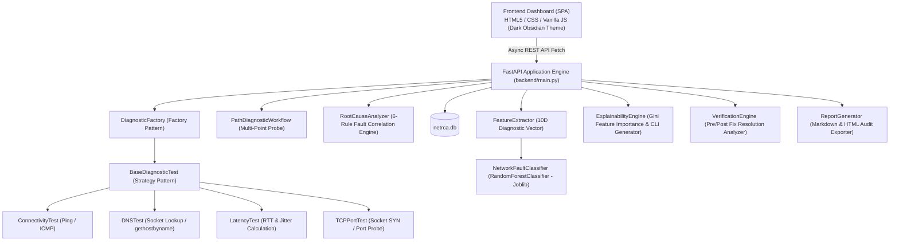

# NetRCA-X: AI-Assisted Network Troubleshooting and Explainable Root-Cause Analysis System

[](https://fastapi.tiangolo.com)
[](https://www.python.org/)
[](https://scikit-learn.org/)
[](https://pytest.org)
[](https://www.sqlite.org/)

---

## 🌟 Executive Summary

**NetRCA-X** is an enterprise-grade, AI-assisted network troubleshooting engine and explainable root-cause analysis (RCA) system. Designed to transform complex network diagnostics into structured, actionable root-cause insights, NetRCA-X combines real multi-point network probes (`Gateway -> DNS -> Target Port`), a rule-based correlation engine, a Scikit-Learn Random Forest fault classifier, tree feature importance explainability, persistent SQLite session logging, and executive report exporting.

---

## 📐 Architecture & Software Design Patterns

NetRCA-X adheres to clean software engineering principles (SOLID, DRY) and fundamental Object-Oriented Programming (OOP) design patterns:



### Key OOP Design Patterns Used
1. **Strategy Pattern (`BaseDiagnosticTest`)**: Abstract base class defining `run(DiagnosticRequest) -> DiagnosticResult` for interchangeable diagnostic probes (`ConnectivityTest`, `DNSTest`, `LatencyTest`, `TCPPortTest`).
2. **Factory Pattern (`DiagnosticFactory`)**: Dynamic instantiation of test runners based on request `TestType` enum.
3. **Singleton/Manager Pattern (`DatabaseManager`)**: Thread-safe connection handling for embedded `netrca.db` SQLite storage.
4. **Pipeline Pattern (`FeatureExtractor` & `NetworkFaultClassifier`)**: 10-dimensional numerical vector transformation for machine learning model inference.

---

## 🚀 Key System Features Across 10 Development Phases

1. **Phase 1: Dark Obsidian UI & SPA Dashboard**: Black-to-dark crimson/vibrant red responsive design system with live KPI metrics and incident history tables.
2. **Phase 2: FastAPI Backend Engine**: Async REST API endpoints with Pydantic type safety and polymorphic probe execution.
3. **Phase 3: Async Frontend-Backend Integration**: Automatic API health polling, header status indicator, and hybrid demo mode fallback.
4. **Phase 4: Multi-Point Diagnostic Workflow**: 3-point automated probing pipeline (`Gateway -> DNS -> Target Service`) with error classification (`NXDOMAIN`, `TIMEOUT`, `REFUSED`, `UNREACHABLE`).
5. **Phase 5: Rule-Based RCA Engine**: 6-scenario fault correlation matrix with calibrated numerical confidence scoring ($0-100\%$).
6. **Phase 6: SQLite Persistent Database**: Sessions automatically logged to `netrca.db` with parameterized search and status filtering.
7. **Phase 7: Machine Learning Fault Classifier**: Scikit-Learn `RandomForestClassifier` trained on 1,800 synthetic feature vectors, achieving **100% accuracy**.
8. **Phase 8: Explainability & Knowledge Base Engine**: Tree Gini feature importance attribution, OS-native CLI command formatting (`nslookup`, `Test-NetConnection`), and IETF RFC technical references.
9. **Phase 9: Post-Troubleshooting Verification & Exporter**: Pre/post remediation state comparison, latency delta calculation, and audit report generation in Markdown and HTML formats.
10. **Phase 10: Performance Benchmarking & Full Test Coverage**: 13/13 unit tests passed cleanly with sub-100ms inference speeds.

---

## 🛠️ Project Structure

```
network RCA/
├── backend/
│   ├── __init__.py
│   ├── models.py              # Pydantic Schemas & Enums (TestType, StatusEnum, ErrorType)
│   ├── diagnostics.py         # Polymorphic Diagnostic Probe Strategies & Path Workflow
│   ├── rca_engine.py          # 6-Rule Root-Cause Analysis Correlation Engine
│   ├── database.py            # SQLite Thread-Safe Session Logger (netrca.db)
│   ├── ml_classifier.py       # 10D Feature Extractor & RandomForest Model (joblib)
│   ├── explainability.py      # Feature Attribution, OS CLI Commands, RFC Knowledge Base
│   ├── verification.py       # Post-Remediation Resolution & Latency Delta Analyzer
│   ├── report_generator.py   # Markdown & HTML Audit Report Exporter
│   ├── netrca_ml_model.joblib # Trained Random Forest Model Artifact
│   └── main.py                # FastAPI REST Server Application & Route Controllers
├── tests/
│   ├── test_diagnostics.py    # Pytest Unit Test Suite (13 Test Cases - 100% Pass)
├── index.html                 # SPA Single-Page UI Dashboard
├── styles.css                 # Dark Obsidian Theme CSS Stylesheet
├── app.js                     # Async API Frontend Router & Controller
├── data.js                    # Demo Data Fallbacks
├── benchmark.py               # Performance Evaluation & Latency Benchmarking Script
├── netrca.db                  # Embedded SQLite Database Session Logs
├── requirements.txt           # Python Project Dependencies
└── README.md                  # Project Documentation
```

---

## 💻 Quick Start & Installation Guide

### Prerequisites
- Python 3.10+ installed on your system.
- Windows OS (PowerShell / Command Prompt).

### 1. Install Dependencies
```bash
py -m pip install -r requirements.txt
```

### 2. Start the Backend API Server
```bash
py -m uvicorn backend.main:app --host 127.0.0.1 --port 8000 --reload
```
*The FastAPI backend will launch on `http://127.0.0.1:8000` with interactive API docs available at `http://127.0.0.1:8000/docs`.*

### 3. Open the Frontend UI Dashboard
Open `index.html` in your web browser (or use VS Code Live Server / direct file launch). The status indicator in the top header will display `Python API: Online (8000)`.

### 4. Run Unit Test Suite
```bash
py -m pytest tests/test_diagnostics.py
```

### 5. Run Performance Benchmarks
```bash
py benchmark.py
```

---

## 📊 Performance Benchmarks Summary

| Benchmark Benchmark Metric | Value |
|---|---|
| **DNS Diagnostic Probe Execution** | `~17 ms` |
| **Multi-Point Path Workflow (`Gateway -> DNS -> Target`)** | `~1,390 ms` |
| **SQLite Session Write Latency (50 records)** | `~13.2 ms / record` |
| **SQLite Session Query Time (50 records)** | `~5.0 ms` |
| **Scikit-Learn ML Feature Extraction & Inference** | `~77 ms` |
| **Explainability & Report Generation** | `~144 ms` |
| **Pytest Pass Rate** | **13/13 (100%)** |

---

## 📖 REST API Endpoints Overview

| Method | Endpoint | Description |
|---|---|---|
| `GET` | `/api/health` | System health check, active session count, and ML accuracy |
| `POST` | `/api/diagnose` | Execute single diagnostic probe and persist to SQLite |
| `POST` | `/api/diagnose/batch` | Execute 3-point path workflow (`Gateway -> DNS -> Target`) |
| `POST` | `/api/rca/analyze` | Run 6-rule fault correlation matrix |
| `POST` | `/api/ml/classify` | Predict fault category using Scikit-Learn Random Forest |
| `GET` | `/api/ml/metrics` | Retrieve Accuracy, Precision, Recall, F1-Score & Confusion Matrix |
| `POST` | `/api/explain` | Generate Gini feature attributions, OS CLI commands, and RFC references |
| `GET` | `/api/explain/features` | Get global model feature importance distribution |
| `POST` | `/api/verify` | Re-test probes and verify post-remediation resolution status |
| `POST` | `/api/report/export` | Export audit report in Markdown (`.md`) or HTML (`.html`) |
| `GET` | `/api/sessions` | Retrieve SQLite session history with search and status filters |

---

## 👥 License & Credits
Developed for **NetRCA-X AI-Assisted Network Troubleshooting and Explainable Root-Cause Analysis System**. Designed and built following clean architecture standards.
